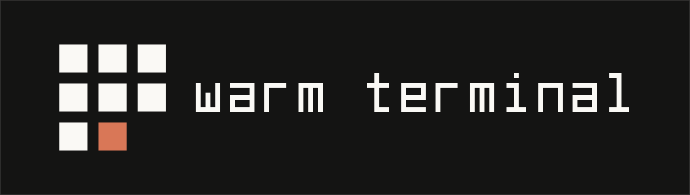

# Warm Terminal

A domain-agnostic design system that makes any screen read like a well-typeset terminal: flat,
ruled, square, with one accent for the current thing. The same rules dress a blog, a landing page,
a shop, a docs site, a portfolio, a dashboard or a tool.

## At a glance

- **Flat.** Square corners, no shadows, no gradients. Depth comes from three surface tones and
  1px lines.
- **Ruled, not boxed.** Products, posts, features, plans and panes are cells of a hairline grid,
  not cards floating on the page.
- **Mono labels, sans text.** JetBrains Mono for labels, nav, buttons, prices, dates and code;
  Inter for headlines and prose. Headlines are sentence case; only mono text is uppercase.
- **One accent.** Orange marks the current thing (active nav item, selected option, focus,
  progress) and nothing else: never a brand wash, never the button fill.
- **Color carries meaning, never alone.** Six terminal hues, each tied to one concept and always
  paired with a word such as `SALE`, `ERR` or `GUIDE`.
- **Words, not icons.** Every control is a word (`ADD TO CART`, `READ MORE →`); when it has a
  shortcut, the key is printed: `[⌘↵]RUN`.
- **Two themes.** Warm near-black (default) and cream paper. Every text color passes WCAG AA in both.
- **Motion as signal.** Short, small movements only to show what changed. Reduced motion keeps
  every static cue.

## What's here

| File                     | Contents                                                                                                                                                                                                                                                                                          |
| ------------------------ | ------------------------------------------------------------------------------------------------------------------------------------------------------------------------------------------------------------------------------------------------------------------------------------------------- |
| [`DESIGN.md`](DESIGN.md) | The full system: YAML design tokens (colors for both themes, type scale, spacing, components), the rules for each part, and domain recipes for blogs, landing pages, shops, docs, dashboards and portfolios                                                                                       |
| [`logo/`](logo/)         | The logo: a ruled grid where one cell is the cursor, in the accent, and the next is still empty. Symbol, horizontal and stacked lockups for both themes, one-colour variants, favicon and web icons, a presentation board, and the usage rules in [`LOGO-GUIDELINES.md`](logo/LOGO-GUIDELINES.md) |

`DESIGN.md` follows the [DESIGN.md format](https://stitch.withgoogle.com/docs/design-md/overview/):
the front matter holds exact values that design agents and tools can read, and the body
explains how to use them.

## How to use it

1. **Hand `DESIGN.md` to your design or coding agent** as the source of visual rules for every
   screen it produces.
2. **Start from the matching domain recipe** in `DESIGN.md` (blog, landing page, shop, docs,
   dashboard, portfolio). It says what the accent marks and which components carry the screen.
   For a domain not listed, apply the five laws and pick the nearest recipe.
3. **Map the hues to your domain once.** Red, green and yellow keep their fixed meanings
   (error / sold out, success / in stock, warning / draft); give blue, cyan and magenta to your
   own concepts (post categories, product labels, data series) and never reuse one for two
   concepts.
4. **Read the token names in the front matter.** Dark values are the default names
   (`surface`, `on-surface`, `accent`); light values carry a `-light` suffix.
5. **Check each screen against "Do's and Don'ts"** at the end of `DESIGN.md` before shipping.

## Quick reference

| Role                  | Dark                              | Light                             |
| --------------------- | --------------------------------- | --------------------------------- |
| surface               | `#141413`                         | `#faf9f5`                         |
| surface raised        | `#1a1a18`                         | `#f1efe8`                         |
| surface panel         | `#1e1d1b`                         | `#ece9e0`                         |
| ink                   | `#faf9f5`                         | `#141413`                         |
| accent                | `#d97757`                         | `#c15f3c` (text `#a94e2f`)        |
| red · green · yellow  | `#e08f8f` · `#c3e88d` · `#e5c07b` | `#a04545` · `#537126` · `#7a5d00` |
| blue · cyan · magenta | `#82aaff` · `#89ddff` · `#c792ea` | `#2a60d6` · `#156f93` · `#8c46bb` |

Type: Inter 400/500/600 for headlines and prose (hero 48 · xl 32 · reading 17/28 at 68ch) ·
JetBrains Mono 400/500 for labels, prices, dates and code · ligatures off.
Spacing: 4pt grid with half steps (4, 6, 8, 10, 12, 16 … 32), 64–96px between page sections.
Strokes: 1px hairline, 2px rule. Radius: 0.
