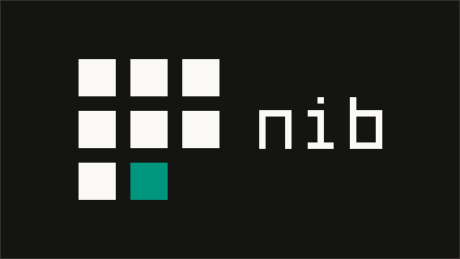

# Nib

**A ruled UI framework, one mark at a time.**

Framework-agnostic CSS and headless components for docs, dashboards and developer tools.

> Status: pre-alpha. Nothing is published yet; the spec and decisions are being settled.

## The idea

- **Flat.** Square corners, no shadows, no gradients. Depth is three surface tones and 1px lines.
- **Ruled, not boxed.** Content sits in cells of a hairline grid, not cards floating on a page.
- **Mono labels, sans text.** JetBrains Mono for labels, nav, buttons, prices and code; Inter for
  headlines and prose.
- **One accent for the current thing.** A jade rule marks where you are; an ink-inverted cursor
  block marks what is chosen. Never a brand wash, never a button.
- **Color carries meaning, never alone.** Six hues, each tied to one concept and paired with a word.

## What's here

| Path | Contents |
|---|---|
| [`spec/DESIGN.md`](spec/DESIGN.md) | The design spec: tokens for both themes, the five laws, components, presets |
| [`brand/`](brand/) | Logo masters, variants, web icons and [`LOGO-GUIDELINES.md`](brand/LOGO-GUIDELINES.md) |
| [`GLOSSARY.md`](GLOSSARY.md) | The names of the system's concepts, and the words to avoid |
| [`docs/adr/`](docs/adr/) | Architecture decision records |
| [`plans/`](plans/) | Decision log and research reports behind the ADRs |

## Planned packages

`@nib-ui/tokens` · `@nib-ui/css` · `@nib-ui/js` · `@nib-ui/react` · `@nib-ui/vue` ·
`@nib-ui/svelte` · `@nib-ui/cli` · `@nib-ui/fonts` · `@nib-ui/icons`

## License

MIT (core). Fonts in `@nib-ui/fonts` are under the SIL Open Font License 1.1.
