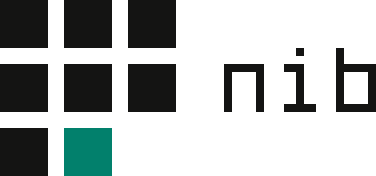

# Nib logo

The mark is a ruled grid of square cells. Seven are ink, one is the cursor in the jade accent (the
point where the nib touches the page), and the last cell is empty: what comes next. It is the
system's laws drawn as a sign: flat, square, ruled, one accent for the current thing.

## Construction

- Grid: 3 × 3 cells of 48 units with 16-unit gaps, 176 units square. Radius 0.
- Cursor: row 3, column 2. Empty: row 3, column 3. Never move, fill or swap them.
- Wordmark: `nib`, drawn from rectangles (stroke 2 units, x-height 12, ascender 16, monospaced
  advance 14). In lockups 1 unit = 4px, so the x-height equals one cell and the baseline sits on
  the middle row's bottom edge. No font is needed; nothing to license.
- Horizontal lockup: mark, one cell (48) of space, wordmark. Stacked: mark centred over the
  wordmark, one cell of space between.
- Reversed (dark) artwork shrinks every cell by 1 unit per side so light-on-dark doesn't look heavier.
- Small cut (`-small`): drawn on a 16px pixel grid (cells 4, gaps 1). Use it at 32px and below.

## Files

| File | Use |
|---|---|
| `nib-mark.svg` · `-dark.svg` | Symbol on light / dark surfaces |
| `nib-mark-small.svg` · `-dark.svg` | Symbol at 16–32px |
| `nib-horizontal.svg` · `-dark.svg` | Default lockup: headers, README, docs |
| `nib-stacked.svg` · `-dark.svg` | Square-ish spaces: covers, social cards |
| `nib-wordmark.svg` · `-dark.svg` | Where the symbol already appears nearby |
| `nib-banner.svg` | Dark lockup on a `#141413` tile with a 1px line: always-white pages such as a GitHub README |
| `variants/` | One-colour black and white (SVG + PNG), square avatar master |
| `web/` | `favicon.ico`, `favicon.svg`, PNG icons, maskable icon, `site.webmanifest`, `head-snippet.html` |
| `source/build-nib-logo.py` | Regenerates every file above, PNG and ICO included; edit geometry and colour here, not in the SVGs |
| `archive/warm-terminal/` | Concept board and slides from the earlier "Warm Terminal" identity, kept for history only |

## Colour

| Role | Light surface | Dark surface |
|---|---|---|
| Cells and wordmark | ink `#141413` | ink `#faf9f5` |
| Cursor cell | jade `#02806c` | jade `#00967d` |
| Background | `#faf9f5` · `#f1efe8` · `#ece9e0` | `#141413` · `#1a1a18` · `#1e1d1b` |

The jade is the system accent (story name: Verdigris). Print values, Pantone and CMYK are not set
yet; they need a print proof. For ink use a rich black (e.g. C60 M50 Y50 K100), not 0/0/4/92.

One-colour: every cell in black or white. The cursor stops being visible, so the empty cell carries
the shape. Use it only where colour is impossible (embossing, fax, single-ink print), never by choice.

## Clear space and minimum size

- Clear space on every side: one cell (48 units, about 27% of the mark's width).
- Symbol: 16px minimum, using the small cut at 32px and below.
- Horizontal lockup: 160px wide minimum. Below that, use the symbol alone.
- Stacked lockup: 120px wide minimum.

## Backgrounds

Use the light artwork on the three light surfaces and the dark artwork on the three dark ones. On
photos or busy content, place the symbol on a square `#141413` tile, as the app icon and favicon do.

## Don't

- Round the cells or the tile, add a shadow, glow, gradient or outline.
- Colour the cursor any hue but the jade accent, or colour other cells jade. Jade means *current*;
  an all-jade logo is a brand wash, which the system forbids.
- Fill the empty cell, move the cursor, add or remove cells, or change the gaps.
- Stretch, rotate, or set the wordmark in a font instead of the drawn letters.
- Add `>_`, a window frame, a chevron or a pen drawing to the mark. The nib is the story, not a picture.
- Animate it beyond the system's motion rules. If it moves, the cursor steps into the empty cell
  (stepped, 110ms frames), and that's all.

## Open items

- Trademark search for "Nib" (classes 9 and 42) before public use. A grid of squares is a common
  motif; check that no registered mark in those classes is too close.
- Pantone and final CMYK values need a print proof.
